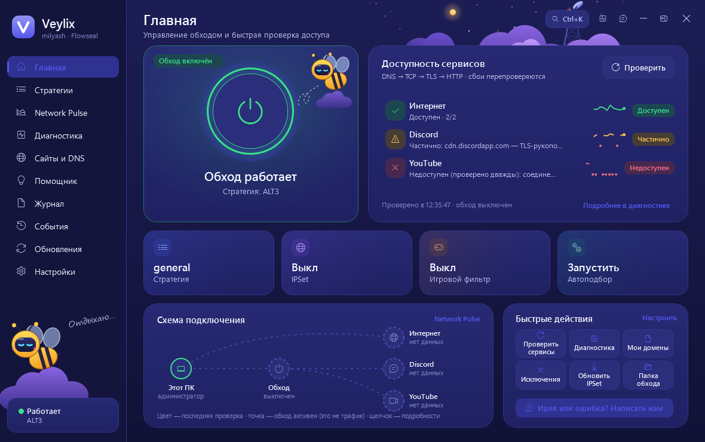
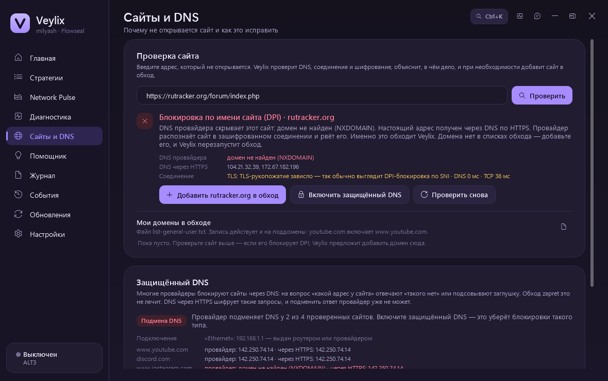
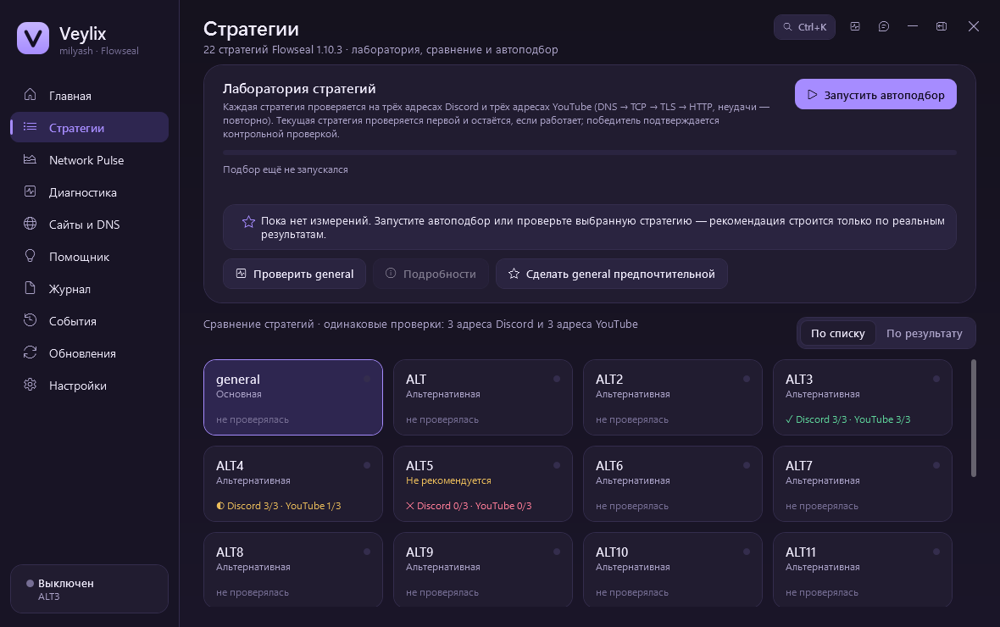
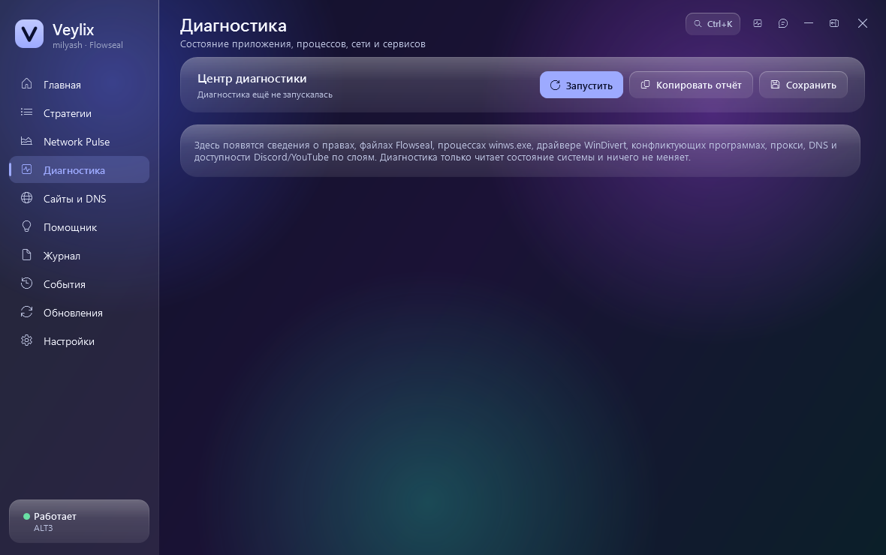
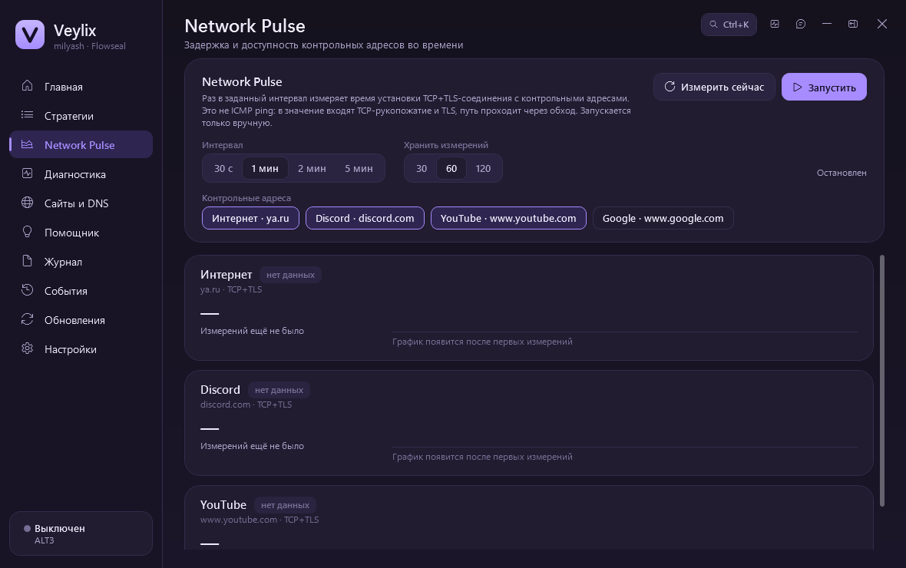
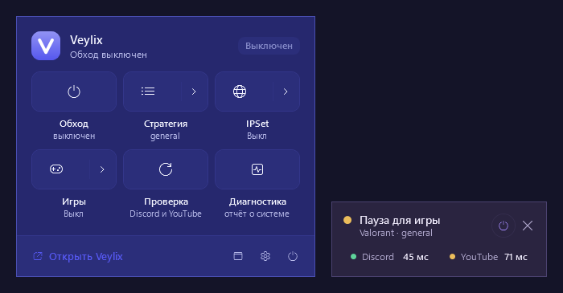
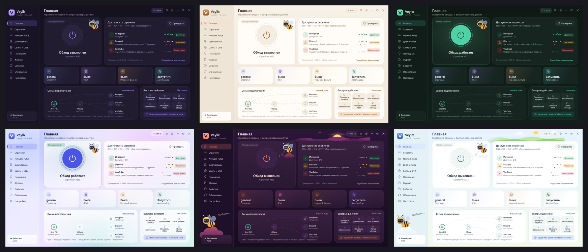

<div align="center">


# Veylix

**Удобная оболочка для [zapret-discord-youtube](https://github.com/Flowseal/zapret-discord-youtube) под Windows.**
Discord и YouTube — одной кнопкой, без `.bat`-файлов и консольных окон.

[](https://github.com/FreeSize83/Veylix/releases/latest)
[](https://github.com/FreeSize83/Veylix/releases)


### [⬇️ Скачать последнюю версию](https://github.com/FreeSize83/Veylix/releases/latest)



</div>

---

## Что это

Veylix запускает оригинальные стратегии Flowseal (`general*.bat`) без изменений, но вместо консоли даёт понятное окно. Можно подобрать рабочую стратегию автоматически, увидеть, что именно не открывается и почему, и получать обновления в один клик.

> Veylix — независимый проект и не связан с Flowseal. Обход выполняет `winws.exe` из zapret через драйвер WinDivert; Veylix только управляет им.

## ✨ Возможности

### 👥 Народная карта стратегий
Главная боль zapret — внезапные «отвалы»: провайдер меняет блокировки, и вчерашняя стратегия перестаёт работать. Veylix показывает, **что прямо сейчас работает у других пользователей вашего провайдера** (и даже региона):

- Например: «У Ростелеком, Самарская обл.: ALT11 работает в 86 % проверок (42 отчёта)» — и кнопка «Включить».
- **Автоподбор сначала проверяет стратегии, которые работают у соседей**, — рабочая находится быстрее, без перебора всего списка.
- **Сигнал о массовом сбое:** если у провайдера за последние часы резко перестал работать Discord или YouTube, Veylix скажет, что дело не в вашем компьютере.
- Отчёты анонимны и только по согласию: название стратегии и «работает / нет». Провайдера и регион определяет сервер, IP-адреса не хранятся. При включённом VPN отчёты не отправляются.

### Обход
- **Одна кнопка** — включить и выключить обход; вывод `winws.exe` попадает в журнал, а не в чёрные окна.
- **Автоподбор стратегии** — Veylix сам проверит стратегии на адресах Discord и YouTube и оставит лучшую, объяснив выбор.
- **Лаборатория стратегий** — проверка, сравнение по результатам и задержке, «предпочтительная» стратегия.
- **IPSet и игровой фильтр** — выбор режима списком прямо на главной.
- **Игровой режим** — пока запущена игра с античитом (Valorant, League of Legends, FACEIT и др.), обход ставится на паузу и сам включается после игры.
- **Автозапуск с Windows** — Veylix стартует в трее и сразу включает последнюю стратегию.

### 🎮 Игры и приложения
- **Отметьте, что не работает, — и всё:** Roblox, League of Legends и Valorant, Rainbow Six Siege, Steam, Epic Games, Battle.net, Minecraft, Warframe, WhatsApp, Twitch и другие. Veylix сам добавит нужные домены в обход и перезапустит его.
- Наборы собраны по самым частым обращениям пользователей zapret и **обновляются автоматически** из этого репозитория ([`presets/apps.json`](presets/apps.json)) — без новой версии программы. Ваши собственные домены при этом не трогаются.

### Сайты и DNS
- **«Почему не открывается сайт?»** — введите адрес, и Veylix проверит DNS, соединение и шифрование и скажет причину: DPI, DNS-подмена, блокировка по IP или сайт просто не работает.
- **Добавить в обход одной кнопкой** — домен попадает в ваш список, обход перезапускается, сайт проверяется снова.
- **Защищённый DNS** — Veylix находит подмену DNS провайдером и включает DNS через HTTPS (Cloudflare или Google) штатными средствами Windows. Вернуть как было — тоже одной кнопкой.

<div align="center">


</div>

### Проверки и диагностика
- **Честная проверка доступности** — по этапам DNS → TCP → TLS → HTTP с повтором неудачных попыток. Проверка сертификатов не отключается.
- **Network Pulse** — график задержки до контрольных адресов (только по запросу).
- **Центр диагностики** — права, файлы, драйвер WinDivert, конфликтующие программы, VPN, прокси, DNS. Отчёт копируется без личных данных.
- **Помощник** — объясняет результаты простым языком и подсказывает конкретные шаги.

<div align="center">


</div>

### Удобство
- **Панель в трее** в стиле Windows 11: обход, стратегия, IPSet и проверка — не открывая окно. Значок в трее показывает состояние цветной точкой.
- **Мини-виджет поверх окон** — состояние, стратегия и задержка до Discord и YouTube в углу экрана.
- **Палитра команд** `Ctrl+K` — любое действие по названию, горячие клавиши, закрепление на главной.
- **9 тем оформления** — светлые, тёмные, «стеклянная» и иллюстрированные; светлый и тёмный режим по системе или по расписанию; Theme Studio для своей темы. И пчёлка-компаньон 🐝
- **Написать разработчику** — идея или ошибка прямо из приложения, без регистрации.
- **Обновления в один клик** — и Veylix, и zapret: с проверкой SHA-256 и автоматическим откатом, если что-то пошло не так. После обновления — короткое окно «Что нового».

<div align="center">

<br><br>

</div>

## 📥 Установка

1. Скачайте `Veylix-X.Y.Z-win-x64.zip` со [страницы последнего релиза](https://github.com/FreeSize83/Veylix/releases/latest).
2. Распакуйте в любую папку.
3. Запустите `Veylix.exe` и разрешите права администратора — они нужны драйверу WinDivert.
4. Нажмите **«Автоподбор»** на главной или просто кнопку питания.

Отдельно ставить zapret не нужно — его файлы уже внутри `Veylix.exe` и распаковываются в `%LOCALAPPDATA%\Veylix\zapret`. Там же хранятся настройки и журналы.

> `Source code (zip)` на странице релиза — это исходники, а не программа. Для запуска нужен `Veylix-X.Y.Z-win-x64.zip`.

**Требования:** Windows 10 или 11 (x64). .NET Framework 4.8 уже есть в Windows 10 (1903+) и 11 — ничего доустанавливать не нужно.

## ⚠️ Антивирусы

Антивирусы иногда помечают `winws.exe` и WinDivert как `HackTool` — это ложное срабатывание на драйвер перехвата пакетов, им пользуется сам zapret. Если файлы пропадают, добавьте в исключения `%LOCALAPPDATA%\Veylix` и папку с `Veylix.exe`. **Отключать антивирус не нужно.**

## 🛠️ Если что-то не работает

| Проблема | Что сделать |
|---|---|
| Не работает игра или приложение (Roblox, Steam, Twitch…) | «Сайты и DNS» → **«Игры и приложения»** → отметьте его. Для серверов игры включите на главной «Игровой фильтр». |
| Не работает Telegram | Telegram в России ограничивают по IP-адресам (маршрутизацией), а не через DPI. zapret, а значит и Veylix, обходит только DPI — с Telegram он помочь не может. |
| Конкретный сайт не открывается | Раздел **«Сайты и DNS»** → введите адрес → следуйте подсказке (обычно «Добавить в обход» или «Включить защищённый DNS»). |
| Вчера работало, сегодня нет | Страница «Стратегии» → **«Народная карта»**: что работает у вашего провайдера сейчас, и нет ли массового сбоя. |
| YouTube или Discord работают частично | **«Автоподбор»** на главной или другая стратегия на странице «Стратегии». |
| В проверке «домен не найден (NXDOMAIN)» | Провайдер подменяет DNS — включите **защищённый DNS** в разделе «Сайты и DNS». |
| Игра с античитом не запускается | Настройки → **«Игровой режим»** → добавьте игру или готовый набор (Vanguard, FACEIT…). |
| Обход не включается | **«Диагностика»** (`Ctrl+D`) покажет причину; чаще всего это антивирус, другой запущенный zapret или VPN. |
| Ничего не помогло | Кнопка **«Написать нам»** на главной: приложите отчёт диагностики — он обезличен. |

Журналы лежат в `%LOCALAPPDATA%\Veylix` (`veylix.log`, `crash.log`).

## 🔄 Обновления

**Veylix** обновляется сам: «Обновления» → «Проверить» → «Обновить». Пакет скачивается только из [релизов этого репозитория](https://github.com/FreeSize83/Veylix/releases), сверяется по SHA-256, прежняя версия сохраняется и возвращается автоматически, если новая не запустится. Настройки не затрагиваются.

**zapret (Flowseal)** обновляется там же из [официального репозитория Flowseal](https://github.com/Flowseal/zapret-discord-youtube/releases) — с переносом ваших списков и возможностью вернуть прошлую версию.

## 🔒 Приватность

- Veylix не собирает статистику и ничего не сообщает о вас. Сам по себе он обращается к GitHub — проверить обновления (отключается в настройках) — и загружает народную карту для вашего провайдера.
- Проверки доступности идут напрямую к проверяемым сайтам.
- Народная карта: результаты проверок отправляются только если вы согласились (можно выключить в настройках) — название стратегии и «работает / нет». Провайдер и регион определяются на сервере по соединению, IP-адреса не сохраняются, данные хранятся 14 дней.
- Сообщение разработчику отправляется только по кнопке «Отправить»; отчёт прикладывается лишь по вашему выбору, имя пользователя, компьютера и IP в нём скрыты.
- Сетевые настройки Windows меняются только если вы сами включите защищённый DNS — и возвращаются кнопкой «Вернуть как было».

## 🧑‍💻 Сборка из исходников

Visual Studio не нужна — используется `csc.exe` из .NET Framework 4.x, который уже есть в Windows.

```bat
git clone https://github.com/FreeSize83/Veylix.git
cd Veylix
build.bat          :: dist\Veylix.exe — один файл, zapret внутри
build.bat test     :: сборка и автотесты
release.bat        :: пакет релиза с контрольной суммой (см. RELEASING.txt)
```

## 🙏 Благодарности

- [Flowseal/zapret-discord-youtube](https://github.com/Flowseal/zapret-discord-youtube) — стратегии и сборка zapret для Windows.
- [bol-van/zapret](https://github.com/bol-van/zapret) — сам zapret и `winws.exe`.
- [WinDivert](https://github.com/basil00/WinDivert) — драйвер перехвата пакетов.

<div align="center">
<sub>Нашли ошибку или есть идея? Кнопка «Написать нам» в приложении или <a href="https://github.com/FreeSize83/Veylix/issues">Issues</a>.</sub>
</div>
